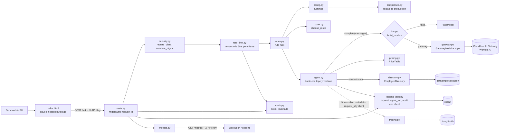
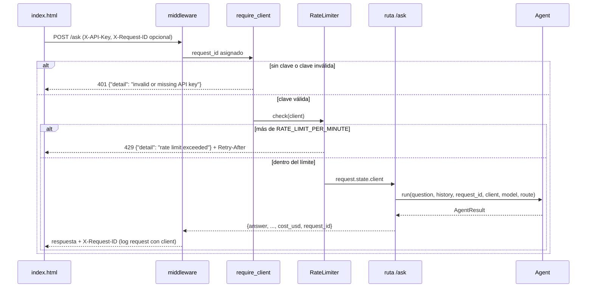

# Arquitectura del HR Assistant

Asistente de RH que responde preguntas sobre empleados desde una página web. API FastAPI sin estado,
un solo agente con bucle con tope y un modelo intercambiable. Desde la sesión 2 cada petición lleva
un `request_id`, deja eventos JSON en stdout, alimenta métricas del proceso y, si se activa, trazas
en LangSmith. Desde la sesión 3 un enrutador elige entre un modelo pequeño y uno capaz, el historial
se recorta, la salida tiene tope, el gateway puede cachear y cada respuesta dice qué costó. Desde la
sesión 4 `/ask` y `/metrics` piden una clave por cliente, hay un límite de peticiones por cliente, la
configuración de producción se revisa al arrancar y el producto se publica en Render en un
contenedor, solo si el CI pasa.

## Componentes

## Una petición con clave y límite

## Del código a producción

```mermaid
flowchart LR
    DEV[Fábrica de agentes] --> AP{Persona aprueba<br/>output/approved.txt}
    AP --> PUB[scripts/publish.py<br/>repo en GitHub + push]
    PUB --> CI[GitHub Actions<br/>.github/workflows/ci.yml]
    CI --> S1[style<br/>pylint 88 col]
    S1 -- needs --> S2[unit<br/>pytest + BDD, cobertura 80 %]
    S2 -- needs --> S3[e2e<br/>Playwright, MODEL_PROVIDER=fake]
    S3 -- needs --> S4[docker<br/>build + /health de la imagen]
    S4 -- "autoDeployTrigger: checksPass" --> RD[Render Blueprint render.yaml<br/>runtime docker, plan free]
    ENV[(Render > Environment<br/>API_KEYS, CF_ACCOUNT_ID, CF_API_TOKEN<br/>sync: false)] -.-> RD
    RD --> IMG[Contenedor Dockerfile<br/>python:3.12-slim, appuser<br/>uvicorn en PORT]
    IMG --> CMP{config.py + compliance.py<br/>ENVIRONMENT=production}
    CMP -- "regla incumplida" --> STOP[No arranca]
    CMP -- "todo en regla" --> HC[healthCheckPath /health]
    HC --> SM[verification production<br/>scripts/smoke.py + SMOKE_API_KEY]
```

### Contenedor (`Dockerfile`)

- Base `python:3.12-slim`. Instala primero `requirements.txt` para reutilizar esa capa y después
  copia solo `app/` y `data/`. `.dockerignore` deja fuera `.env`, pruebas, `doc/`, `scripts/`, el
  CI y los archivos de Render.
- Corre como `appuser` (uid 10001), nunca como root.
- `PYTHONUNBUFFERED=1`: el log JSON sale a stdout al momento, que es donde Render lo recoge.
- Arranca con `exec uvicorn app.main:app --host 0.0.0.0 --port ${PORT:-8000}`: Render fija `PORT`;
  en local se usa 8000. `exec` deja a uvicorn como proceso principal para recibir el apagado.
- La imagen no lleva ninguna clave: todo llega por variables de entorno al correrla.

### CI (`.github/workflows/ci.yml`)

Corre en cada `push` y `pull_request`, con permisos de solo lectura; una corrida nueva de la misma
rama cancela la anterior. Cuatro trabajos encadenados con `needs`: si uno falla, los siguientes no
corren y Render no publica.

| Etapa | Qué comprueba |
| --- | --- |
| `style` | `pylint app tests` con 88 columnas y nota mínima 10 |
| `unit` | `pytest tests` (unitarias y BDD) con cobertura de `app` de al menos 80 % |
| `e2e` | Arranca el producto con `MODEL_PROVIDER=fake` y corre `pytest e2e` en Chromium (Playwright) |
| `docker` | `docker build` de la imagen y comprueba que el contenedor responde en `/health` |

El CI usa una clave de ejemplo pública (`CI_API_KEY`), que no es un secreto ni sirve en Render. En
`e2e` la misma clave va en `API_KEYS` para arrancar el producto y en `E2E_API_KEY` para que la
prueba la escriba en la página; sin `E2E_API_KEY` las pruebas de punta a punta fallan.

### Render (`render.yaml`)

- Blueprint con un servicio `web` llamado `hr-assistant`, `runtime: docker`, `plan: free`,
  `dockerfilePath: ./Dockerfile` y `healthCheckPath: /health`.
- `autoDeployTrigger: checksPass`: Render publica un commit solo cuando el CI de GitHub pasa.
- Variables fijas en el Blueprint: `ENVIRONMENT=production`, `MODEL_PROVIDER=gateway`,
  `HIDE_INPUTS=true`, `HIDE_OUTPUTS=true`. Con `ENVIRONMENT=production`, `compliance.py` impide
  arrancar si la configuración incumple una regla (ADR 0012); el health check falla y Render no
  pasa el tráfico a esa versión.
- Secretos con `sync: false` (`API_KEYS`, `CF_ACCOUNT_ID`, `CF_API_TOKEN`): nunca se escriben en
  el repositorio; una persona los pone a mano en Render > Environment (Render los pide al crear el
  Blueprint). `LANGSMITH_API_KEY` es opcional y se agrega igual si se encienden las trazas.
- El plan gratuito duerme el servicio sin tráfico; el primer pedido puede tardar hasta un minuto.

### Prueba de humo (`scripts/smoke.py`)

Tras publicar, `SMOKE_API_KEY=<clave> python scripts/smoke.py https://<servicio>.onrender.com`
(o `verification production <url>` desde la raíz) comprueba tres cosas: `GET /health` da 200,
`POST /ask` sin clave da 401 y `POST /ask` con clave da 200. La clave se lee solo de la variable
`SMOKE_API_KEY`, nunca de un argumento, y nunca se imprime. Sale con 0 si todo pasa, 1 si algo
falla y 2 si el uso es incorrecto; espera hasta 90 s por respuesta por el arranque en frío.

## Decisiones

- [0001. API sin estado](adr/0001-stateless-api.md)
- [0002. Interfaz del modelo](adr/0002-model-interface.md)
- [0003. Bucle con tope](adr/0003-bounded-agent-loop.md)
- [0004. Request id y log JSON](adr/0004-request-id-and-json-logs.md)
- [0005. Métricas por proceso](adr/0005-per-process-metrics.md)
- [0006. Trazas opcionales en LangSmith](adr/0006-optional-langsmith-tracing.md)
- [0007. Enrutamiento por regla en código](adr/0007-rule-based-routing.md)
- [0008. Costo con tabla de precios local](adr/0008-cost-accounting.md)
- [0009. Modelo real por AI Gateway](adr/0009-gateway-provider.md)
- [0010. Clave por cliente](adr/0010-per-client-api-keys.md)
- [0011. Límite de peticiones en memoria](adr/0011-in-process-rate-limit.md)
- [0012. Compliance al arrancar y publicación con CI](adr/0012-compliance-and-gated-deploy.md)
