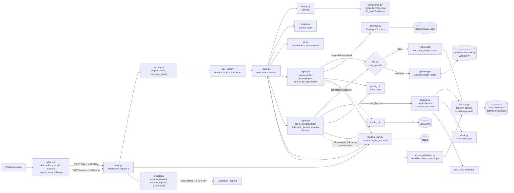

# Arquitectura del HR Assistant

Asistente de RH que responde preguntas sobre empleados desde una página web. API FastAPI sin estado,
un solo bucle de agente con tope y un modelo intercambiable. Desde la sesión 2 cada petición lleva
un `request_id`, deja eventos JSON en stdout, alimenta métricas del proceso y, si se activa, trazas
en LangSmith. Desde la sesión 3 un enrutador elige entre un modelo pequeño y uno capaz, el historial
se recorta, la salida tiene tope, el gateway puede cachear y cada respuesta dice qué costó. Desde la
sesión 4 `/ask`, `/invoice` y `/metrics` piden una clave por cliente, hay un límite de peticiones
por cliente, la configuración de producción se revisa al arrancar y el producto se publica en Render
en un contenedor, solo si el CI pasa.

Reto de facturación (`spec/05-facturacion.md`): `POST /invoice` convierte una frase en un
**borrador de factura** sin validez fiscal. El modelo solo interpreta la frase; el código resuelve
cliente y conceptos contra un catálogo cerrado, calcula con `Decimal`, valida la factura y
enmascara PII (ADR 0014, 0015 y 0016). No se guarda nada.

Pendiente (ADR 0013, propuesto): juntar en un solo error todas las `CF_*` faltantes y las reglas de
compliance, y ensayar el arranque de producción en el CI. Hoy `load_settings` todavía corta en la
primera `CF_*` que falta.

## Componentes



## Una factura

```mermaid
sequenceDiagram
    participant W as index.html
    participant MW as middleware + require_client
    participant INV as ruta /invoice
    participant PII as pii.py
    participant AG as agente de facturación
    participant M as modelo
    participant SV as InvoiceService
    participant VAL as invoice_validation
    W->>MW: POST /invoice {text} + X-API-Key
    MW-->>W: 401 / 429 si no hay clave o pasa el límite
    MW->>INV: cliente autenticado (422 si text vacío o largo)
    INV->>PII: detect(text), mask(text)
    INV->>AG: run(texto enmascarado, request_id, client, ruta)
    AG->>M: [factura] + frase enmascarada
    M-->>AG: {"tool": "crear_factura", "args": {cliente, conceptos}}
    AG->>SV: create(cliente, conceptos)
    alt cliente, rango o conceptos inválidos
        SV-->>AG: rechazo guardado (motivo)
    else válido
        SV-->>AG: factura guardada; al modelo, JSON con RFC enmascarado
    end
    AG->>M: Resultado de la herramienta: ...
    M-->>AG: {"answer": "Factura ... creada ..."}
    AG-->>INV: AgentResult (tokens, costo)
    alt rechazo o sin llamada a la herramienta
        INV-->>W: 422 {"detail": motivo en español} + audit invoice_rejected
    else factura
        INV->>VAL: validate(factura, catálogo)
        alt no cuadra
            INV-->>W: 500 {"detail": "invoice failed validation"} + audit
        else cuadra
            INV-->>W: 200 {invoice con RFC completo, ..., pii_detected} + audit invoice_created
        end
    end
```

### Reglas de la factura

- El modelo manda `cliente` (texto) y `conceptos` (`{concepto, cantidad}`); nunca precios, ids ni
  totales. El código compara sin acentos ni mayúsculas contra `nombre` y `aliases`; gana el alias
  más largo, sin traslapes, y el alias del cliente debe aparecer en la frase.
- Orden de rechazos: `cliente no encontrado`, `cantidad o número de líneas fuera de rango` (1 a
  `MAX_LINE_QUANTITY`, máximo `MAX_INVOICE_LINES` líneas), `no se reconoció ningún concepto del
  catálogo`. Los conceptos no reconocidos se omiten si queda al menos uno.
- `importe = cantidad × precio_unitario`; `iva` = 16 % del subtotal con `ROUND_HALF_UP`; todo con
  `Decimal` y en la respuesta como texto con 2 decimales, moneda `MXN`, `estado` `borrador`.
- Solo cuenta la primera llamada válida a `crear_factura`. La respuesta usa la factura guardada por
  el código, no el texto final del modelo.

### PII

Se detectan RFC, CURP, correo y teléfono de 10 dígitos. Con `PII_MASKING=true` el modelo recibe
`[RFC]`, `[CURP]`, `[EMAIL]`, `[TELEFONO]` y el RFC del cliente como `FLO*****AB1`. Logs, auditoría
y trazas llevan solo tipos. La factura que recibe la persona autenticada trae el RFC completo; ese
RFC no cuenta en `pii_detected`.

## Del código a producción

```mermaid
flowchart LR
    DEV[Fábrica de agentes] --> CHK{Lista previa<br/>secretos en Render<br/>SMOKE_API_KEY definida}
    CHK --> AP{Persona aprueba<br/>output/approved.txt}
    AP --> PUB[scripts/publish.py<br/>repo en GitHub + push]
    PUB --> CI[GitHub Actions<br/>.github/workflows/ci.yml]
    CI --> S1[style<br/>pylint 88 col]
    S1 -- needs --> S2[unit<br/>pytest + BDD, cobertura 80 %]
    S2 -- needs --> S3[e2e<br/>Playwright, MODEL_PROVIDER=fake]
    S3 -- needs --> S4[docker<br/>build + /health]
    S4 -- "autoDeployTrigger: checksPass" --> RD[Render Blueprint render.yaml<br/>runtime docker, plan free]
    ENV[(Render > Environment<br/>API_KEYS, CF_ACCOUNT_ID, CF_API_TOKEN<br/>sync: false)] -.-> RD
    RD --> IMG[Contenedor Dockerfile<br/>python:3.12-slim, appuser<br/>app/ y data/ con catálogos]
    IMG --> CMP{config.py + compliance.py<br/>ENVIRONMENT=production}
    CMP -- "reglas incumplidas<br/>p. ej. PII_MASKING=false" --> STOP[No arranca]
    CMP -- "todo en regla" --> HC[healthCheckPath /health]
    HC --> SM[verification production<br/>scripts/smoke.py + SMOKE_API_KEY]
```



### Arranque (`config.py`)

`load_settings` valida el formato de cada variable (enteros, booleanos, rutas de datos y de
catálogos, `API_KEYS`); `catalog.py` valida el contenido de los catálogos. Con
`ENVIRONMENT=production`, `compliance.py` impide arrancar si `MODEL_PROVIDER=fake`, si faltan claves
o son cortas, si las trazas no ocultan datos o si `PII_MASKING` no es `true`. Los errores nombran
variables, nunca valores.

### Contenedor (`Dockerfile`)

- Base `python:3.12-slim`. Instala primero `requirements.txt` y después copia solo `app/` y `data/`
  (empleados, precios y los dos catálogos). `.dockerignore` deja fuera `.env`, pruebas, `doc/`,
  `scripts/`, el CI y los archivos de Render.
- Corre como `appuser` (uid 10001), nunca como root. `PYTHONUNBUFFERED=1` para el log JSON.
- Arranca con `exec uvicorn app.main:app --host 0.0.0.0 --port ${PORT:-8000}`.
- La imagen no lleva ninguna clave: todo llega por variables de entorno.

### CI (`.github/workflows/ci.yml`)

| Etapa | Qué comprueba |
| --- | --- |
| `style` | `pylint app tests` con 88 columnas y nota mínima 10 |
| `unit` | `pytest tests` (unitarias y BDD) con cobertura de `app` de al menos 80 % |
| `e2e` | Arranca el producto con `MODEL_PROVIDER=fake` y corre `pytest e2e` en Chromium, incluida la sección de factura |
| `docker` | `docker build`; la imagen responde en `/health` |

### Render (`render.yaml`)

- Servicio `web` con `runtime: docker`, `plan: free`, `healthCheckPath: /health` y
  `autoDeployTrigger: checksPass`.
- Variables fijas: `ENVIRONMENT=production`, `MODEL_PROVIDER=gateway`, `HIDE_INPUTS=true`,
  `HIDE_OUTPUTS=true`, `PII_MASKING=true`. Los catálogos usan sus rutas por omisión.
- Secretos con `sync: false` (`API_KEYS`, `CF_ACCOUNT_ID`, `CF_API_TOKEN`), escritos a mano por
  una persona en Render > Environment.

### Prueba de humo (`scripts/smoke.py`)

`SMOKE_API_KEY=<clave> python scripts/smoke.py https://<servicio>.onrender.com` comprueba `/health`,
`POST /ask` sin clave (401) y con clave (200). La clave se lee solo de la variable y nunca se
imprime.

## Decisiones

- [0001. API sin estado](adr/0001-stateless-api.md)
- [0002. Interfaz del modelo](adr/0002-model-interface.md)
- [0003. Bucle con tope](adr/0003-bounded-agent-loop.md)
- [0004. Request id y log JSON](adr/0004-request-id-and-json-logs.md)
- [0005. Métricas por proceso](adr/0005-per-process-metrics.md)
- [0006. Trazas opcionales en LangSmith](adr/0006-optional-langsmith-tracing.md)
- [0007. Enrutamiento por regla en código](adr/0007-rule-based-routing.md)
- [0008. Costo con tabla de precios local](adr/0008-cost-accounting.md)
- [0009. Modelo real por AI Gateway](adr/0009-gateway-provider.md)
- [0010. Clave por cliente](adr/0010-per-client-api-keys.md)
- [0011. Límite de peticiones en memoria](adr/0011-in-process-rate-limit.md)
- [0012. Compliance al arrancar y publicación con CI](adr/0012-compliance-and-gated-deploy.md)
- [0013. Secretos de producción: error completo y ensayo en el CI](adr/0013-production-boot-rehearsal.md) (propuesto, pendiente)
- [0014. El modelo interpreta, el código calcula](adr/0014-model-interprets-code-calculates.md)
- [0015. PII enmascarada antes del modelo](adr/0015-pii-masking.md)
- [0016. Agente de facturación con mínimo privilegio](adr/0016-least-privilege-invoice-agent.md)
